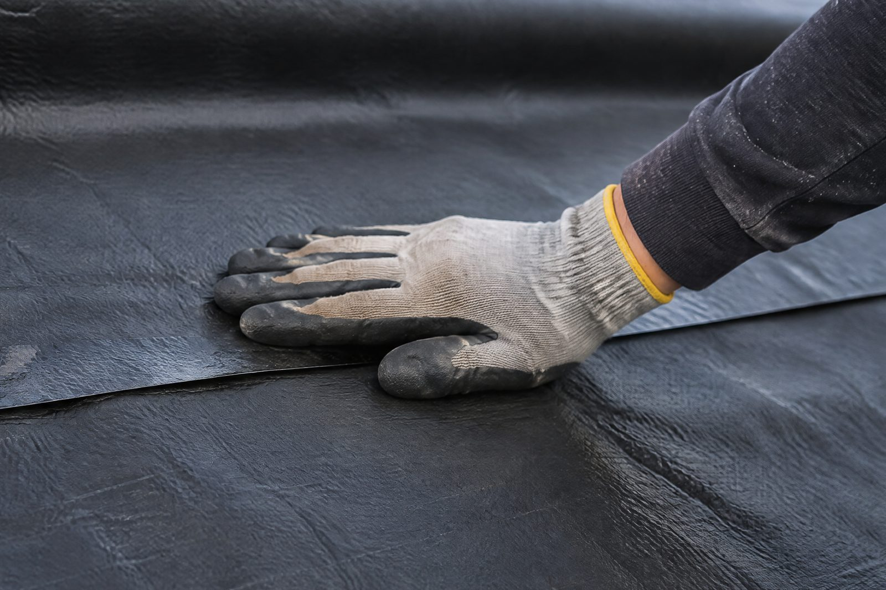

Item AHSP untuk genteng aspal dibuat untuk lembaran 0,8 × 1 m, bukan shingle, sehingga RAB (rencana anggaran biaya) atap bitumen perlu analisa tersendiri. Artikel ini untuk kontraktor, konsultan, estimator, dan mahasiswa yang perlu menyusun analisa pekerjaan atap bitumen (genteng aspal shingle) per m² dengan koefisien yang bisa ditelusuri, dan untuk pemilik rumah yang ingin memeriksa RAB dari kontraktornya.

## Item AHSP PUPR yang ada, dan kenapa tidak cocok untuk shingle

AHSP (analisa harga satuan pekerjaan) Bidang Cipta Karya yang berlaku sekarang, Lampiran VI SE Dirjen Bina Konstruksi 182/SE/Dk/2025, memuat dua item genteng aspal:

| Item | Bahan per satuan | Tenaga per satuan |
|---|---|---|
| 3.1.3.6 Pemasangan 1 m² atap aspal/bitumen | Genteng aspal 0,8 × 1 m 1,50 buah, plywood 6 mm 0,35 lembar, paku 0,03 kg, plastik aerator 0,50 buah | Pekerja 0,20, tukang kayu 0,30, kepala tukang 0,03, mandor 0,01 OH |
| 3.1.3.13 Pemasangan 1 m’ nok/bubung genteng aspal/bitumen | Nok 2 buah, paku 0,05 kg, balok kayu kelas III 0,0035 m³ | Pekerja 0,125, tukang kayu 0,25, kepala tukang 0,025, mandor 0,0083 OH |

Edisi sebelumnya (Bagian IV AHSP Bidang Cipta Karya dan Perumahan) memuat item yang sama dengan kode A.4.5.2.33 dan A.4.5.2.37; bedanya, kepala tukang di sana 0,003 OH per m² dan mandor nok 0,006 OH. OH adalah orang-hari: jumlah hari kerja satu orang untuk satu satuan pekerjaan.

Shingle berukuran lain. CTI CT3, misalnya, 1.000 × 333 mm, 21 lembar per bundel 3 m² atau 7 lembar per m², dan panduan pemasangan CTI memintanya dipasang di atas papan minimal 9 mm dengan underlayer, flashing, dan starter. Item di atas tidak memuat underlayer, flashing, maupun starter, dan alasnya plywood 6 mm. Jadi RAB shingle yang memakainya tidak menggambarkan pekerjaan sesuai panduan pabrik.

Pedomannya sendiri menyediakan jalur. Merujuk Permen PUPR 8/2023 Pasal 17 ayat (1), SE Dirjen Bina Konstruksi 182/SE/Dk/2025 menyebut bahwa bila AHSP yang diperlukan belum ada, dapat dipakai AHSP lain dalam Permen atau SE tersebut, referensi lain berdasarkan pendekatan SNI, atau perhitungan teknis dan analisis produktivitas yang diusulkan melalui Pimpinan Tinggi Madya kepada unit yang membidangi jasa konstruksi. Analisa di bawah adalah perhitungan teknis dari panduan pabrik dan angka hitung Atapura; untuk proyek pemerintah, pemakaiannya tetap mengikuti jalur usulan tersebut.

## Koefisien bahan atap bitumen per m²

Per m² atap bitumen di atas multiplek 12 mm (angka hitung Atapura, 20 November 2026): genteng 1,10 m², multiplek 0,353 lembar, underlayer 0,11 roll, paku 35 buah, sekrup 5,3 buah; flashing 1 batang per 1,2 m keliling dan starter 0,125 m² per meter keliling.

| Uraian | Koefisien per m² | Dasar |
|---|---|---|
| Genteng aspal | 1,10 m² | Luas + 10% potongan; dibagi isi bundel per seri |
| Multiplek 12 mm | 0,353 lembar | 1,05 m² ÷ 2,9768 m² per lembar (1,22 × 2,44 m) |
| atau GRC 9 mm | 0,365 lembar | 1,05 m² ÷ 2,88 m² per lembar |
| Underlayer self-adhesive | 0,11 roll | 1,10 m² ÷ 10 m² per roll |
| Paku genteng | 35 buah | Angka hitung Atapura |
| Sekrup papan | 5,3 buah | 15 per lembar papan (angka hitung Atapura; panduan CTI: jarak sekrup 300 mm) |
| Flashing U | Keliling ÷ 1,2 m | Profil penutup tepi papan alas, 1,2 m per batang |
| Starter | Keliling × 0,125 m | Lajur genteng tanpa lidah selebar 12,5 cm di keliling atap, dihargai sebagai genteng per m² |

Flashing dan starter dihitung dari keliling, yaitu jumlah panjang semua tepi atap, bukan dari luas. Atap kecil atau bersudut banyak punya keliling lebih panjang per m², jadi harga per m²-nya sedikit naik. Isi bundel per seri, untuk mengubah 1,10 m² genteng menjadi jumlah bundel, ada di [harga & ukuran atap bitumen per lembar](/panduan/ukuran-harga-genteng-aspal-per-lembar).

Faktor underlayer 1,1 adalah angka hitung Atapura. Dengan roll selebar 1 m dan sambungan 100–150 mm, lebar efektif tiap lajur 0,85–0,90 m, jadi untuk RAB yang ketat hitung jumlah roll dari jumlah lajur di gambar atap. Jenis dan tebal underlayer ada di [underlayer atap bitumen](/panduan/underlayer-atap-bitumen).

*Ilustrasi, bukan proyek Atapura. Panduan CTI meminta sambungan underlayment menumpuk 150 mm pada kemiringan 10°–15° dan 100 mm di atas 15°.*

## Koefisien tenaga kerja dan jasa pasang

Atapura menghitung jasa pasang per m², Rp70–120 ribu di Jabodetabek ([rincian ongkos jasa pasang](/panduan/ongkos-jasa-pasang-atap-bitumen)), untuk semua lapis di atas rangka: papan alas, flashing, underlayer, starter, genteng, dan nok. Produktivitasnya sekitar 30–45 m² per hari per tim.

Di RAB, angka ini bisa dipakai sebagai satu baris upah borongan per m². Bila format RAB Anda meminta koefisien OH, hitung per peran: koefisien = jumlah orang dengan peran itu ÷ luas yang dipasang tim per hari, lalu kalikan dengan upah harian dari daftar harga daerah Anda. Koefisien OH pada item PUPR di atas dibuat untuk lembaran 0,8 × 1 m, jadi tidak langsung berlaku untuk shingle.

## Contoh analisa harga satuan 1 m²: CTI CT3 di atas multiplek

Asumsi: atap persegi 10 × 10 m (100 m², keliling 40 m), harga jual Atapura Jabodetabek per 20 November 2026, di atas rangka yang sudah ada.

| Uraian | Koefisien × harga satuan | Jumlah per m² |
|---|---|---|
| **A. Tenaga kerja** | | |
| Jasa pasang (borongan per m²) | 1 m² × Rp70.000–120.000 | Rp70.000–120.000 |
| **B. Bahan** | | |
| Genteng CTI CT3 | 1,10 m² × Rp155.000 | Rp170.500 |
| Multiplek 12 mm | 0,353 lembar × Rp179.000 | Rp63.200 |
| Underlayer | 0,11 roll × Rp600.000 | Rp66.000 |
| Flashing U | 0,333 batang × Rp40.000 | Rp13.300 |
| Starter | 0,05 m² × Rp155.000 | Rp7.800 |
| Paku | 35 × Rp250 | Rp8.800 |
| Sekrup | 5,3 × Rp150 | Rp800 |
| Jumlah bahan | | Rp330.400 |
| **D. Jumlah (A + B)** | | Rp400.400–450.400 |
| **E. Biaya umum dan keuntungan** | Sudah di harga jual Atapura | – |
| **F. Harga satuan pekerjaan** | | sekitar Rp400.000–450.000 |

Hasilnya masuk kisaran harga terpasang CTI Rp400–450 ribu per m² di [harga atap bitumen per m²](/panduan/harga-atap-bitumen-per-m2), karena dihitung dengan angka yang sama. Saat belanja dibulatkan ke satuan utuh (37 bundel, 36 lembar multiplek, 11 roll, 34 batang flashing untuk atap 100 m²), bahan naik sedikit menjadi sekitar Rp333 ribu per m². Untuk merek lain, ganti baris genteng dengan harga per m² seri yang dipilih.

Untuk kota lain, koefisiennya tetap; ganti harga satuannya dengan daftar harga daerah Anda (HSPK atau SSH, daftar harga satuan resmi pemda) atau hasil survei harga toko setempat. Bila daftar daerah belum memuat genteng aspal shingle atau underlayer, pakai harga survei atau penawaran pemasok dan lampirkan sumbernya.

## Memindahkan ke RAB

Volume pekerjaan atap adalah luas bidang miring, bukan luas lantai: luas denah atap termasuk teritis dikali faktor kemiringan (1 ÷ cos sudut atap). Panjang tepi untuk flashing dan starter diukur dari gambar yang sama.

Di RAB, hasil analisa masuk sebagai satu baris: uraian "Penutup atap genteng aspal shingle, termasuk papan alas multiplek 12 mm, underlayer, flashing, dan starter", satuan m², volume dari gambar, dan harga satuan dari analisa ini. Untuk atap CTI 100 m²: 100 × Rp400.000–450.000 = Rp40–45 juta, sebelum rangka dan biaya lain di bawah.

## Item terpisah di RAB atap bitumen

- **Rangka atap**, baja ringan atau kayu, per m² bidang atap.
- **Bongkar atap lama** dan buang puing.
- **Nok dan jurai luar.** Pada analisa di atas, nok dibuat dari potongan genteng yang masuk tambahan 10%, dan jasanya sudah termasuk jasa pasang. Bila format RAB memisahkan nok dan jurai sebagai item per meter lari, ukur panjangnya dari gambar dan jangan hitung dobel dengan tambahan 10% tadi.
- **Flashing dinding, talang, dan lisplang** per meter lari sesuai gambar ([nok, flashing, dan talang](/panduan/nok-flashing-talang-atap-bitumen)).
- **Scaffolding**, bila diperlukan.
- **Biaya umum dan keuntungan**: SE 182/SE/Dk/2025 menetapkannya dalam interval 10–15% dari jumlah tenaga kerja, bahan, dan peralatan. Harga di contoh atas sudah harga jual Atapura, jadi jangan ditambah komponen ini lagi; tambahkan hanya bila memakai harga dasar sendiri.

## Untuk pemilik rumah yang menerima RAB

Cek empat hal di baris atap: alasnya multiplek atau GRC minimal 9 mm, bukan plywood 6 mm; underlayer, flashing, dan starter tertulis; volumenya luas atap miring, bukan luas lantai; rangka dan bongkar atap lama ditulis sebagai baris sendiri. Untuk membandingkan harganya, masukkan luas dan merek di [Hitung AKAL](/hitung).

Spesifikasi teknis untuk RKS, dari rangka sampai nok, ada di [spesifikasi teknis atap bitumen](/panduan/spesifikasi-teknis-atap-bitumen-rks), dan urutan pekerjaannya di [cara pasang atap bitumen](/panduan/cara-pasang-atap-bitumen). Untuk proyek dengan volume besar, kirim gambar kerja atau BoQ (daftar volume per item pekerjaan) lewat WhatsApp; admin mengirim [penawaran tertulis](/perusahaan) yang merinci material, aksesoris, jasa, dan perkiraan hari kerja. Survey di Jabodetabek tanpa biaya; proyek di luar Jabodetabek dihitung bersama admin.
