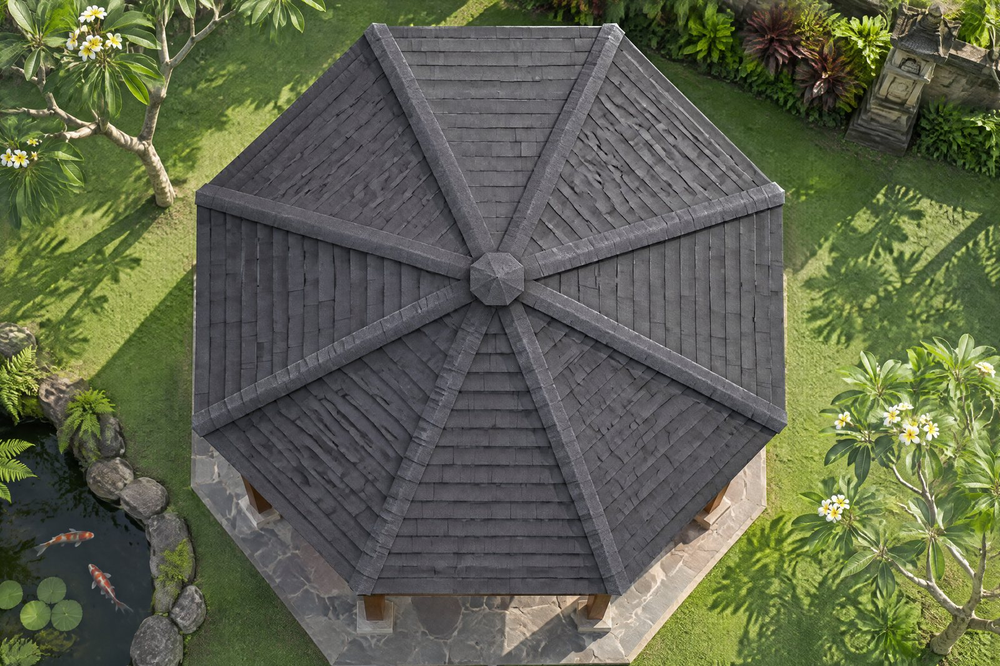
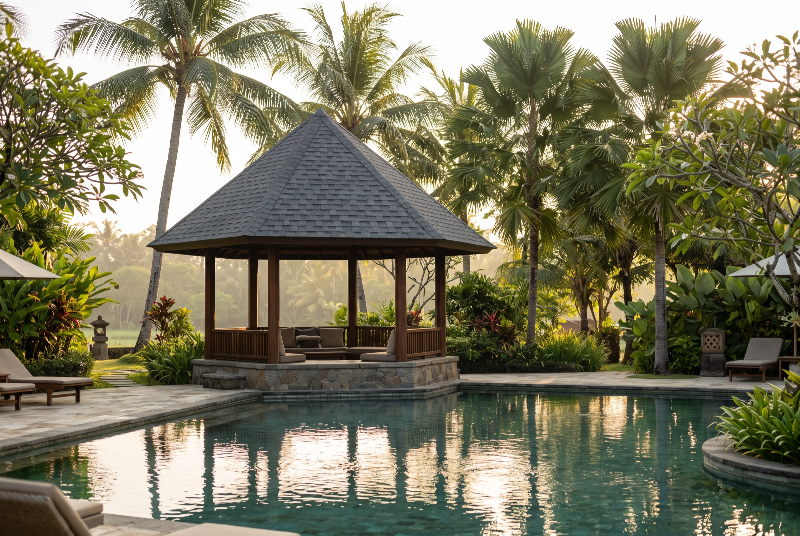

Atap gazebo berbeda dari atap rumah dalam dua hal. Atapnya terlihat dari segala arah, termasuk dari bawah karena biasanya tanpa plafon, dan bentuknya hampir selalu limas atau segi delapan dengan banyak jurai. Dua hal itu yang paling menentukan pilihan bahannya.

## Jenis bahan atap gazebo dan umurnya

| Bahan | Berat dan umur | Catatan untuk gazebo |
|---|---|---|
| Genteng aspal (atap bitumen) | 8,5–12,3 kg per m²; tabel umur Amerika 20–30 tahun, garansi pabrik Maxxi dan CTI 25–30 tahun | Mudah dipotong mengikuti limas dan segi delapan; butuh papan alas |
| Genteng tanah liat, keramik, beton | Keramik 39–46 kg per m²; lebih dari 50 tahun (NAHB), 100 tahun lebih (InterNACHI), 40 tahun (Fannie Mae) | Butuh rangka dan tiang yang kuat; genteng keramik butuh sudut minimal 25–30° |
| Sirap kayu | Tabel umur Amerika 25–30 tahun untuk sirap kayu cedar | Tampilan alami; umur sirap kayu lokal tidak tercantum |
| Metal (spandek, genteng metal) | Ringan; tabel umur 40–80 tahun | Bisa sangat landai; tanpa plafon, bunyi hujan langsung terdengar ke bawah |
| Alang-alang, ijuk, polikarbonat | Tidak tercantum di tabel umur yang kami pakai | Tampilan khas, atau terang untuk pergola |

Angka umur diambil dari tabel umur bangunan Amerika Serikat yang dimuat ulang dalam satu laporan teknis (sumber di bawah). Perbandingan lengkapnya ada di [jenis atap rumah paling awet](/panduan/jenis-atap-rumah-paling-awet).

Untuk gazebo, berat atap menentukan besar tiang dan rangkanya. Pedoman pembebanan PPURG 1987 menghitung atap genteng beserta reng dan usuknya 50 kg per m², sedangkan genteng aspal hanya 8,5–12,3 kg per m² untuk gentengnya, ditambah underlayer dan papan alas. Hitungan berat terpasangnya ada di [berat atap bitumen per m²](/panduan/berat-atap-bitumen-per-m2). Gazebo yang sudah berdiri dengan tiang ramping biasanya lebih aman memakai atap ringan.

## Bentuk atap gazebo: limas, segi delapan, pelana

*Ilustrasi, bukan proyek Atapura. Delapan bidang segitiga, delapan jurai, satu puncak.*

Atap limas dan segi delapan terdiri dari bidang-bidang segitiga yang bertemu di satu puncak. Setiap garis pertemuan (jurai) perlu ditutup, jadi semakin banyak sisinya, semakin banyak jurainya. Genteng aspal cocok di sini karena lembarannya dipotong di tempat, dan jurainya ditutup potongan genteng yang dilipat, sama seperti cara pasang nok di panduan CTI untuk seri CT3 dan CT5, sehingga warnanya menyatu dengan atap.

Panduan CTI punya aturan khusus untuk bidang segitiga: genteng dipasang mengacu pada garis as di tengah bidang, dari sisi kanan dan kiri bergantian, mulai dari bawah ke atas. Dengan cara ini baris genteng tetap lurus dan simetris saat dilihat dari depan. Urutan pasangnya ada di [cara pasang atap bitumen](/panduan/cara-pasang-atap-bitumen).

Gazebo minimalis atau modern biasanya beratap pelana atau limas yang lebih landai dengan warna polos. Genteng aspal bisa dipasang mulai 15°, dan merek tertentu 10–15° dengan cara pasang khusus. Pergola yang hampir datar tidak cocok untuk genteng aspal; pilihannya lembaran metal atau polikarbonat. Batas tiap merek ada di [kemiringan atap bitumen minimal](/panduan/kemiringan-atap-bitumen-minimal), dan pilihan warnanya di [warna atap bitumen untuk rumah minimalis](/panduan/warna-atap-bitumen-rumah-minimalis).

## Bagian bawah atap yang terlihat dari dalam

Di rumah, papan alas tertutup plafon. Di gazebo, papan itu biasanya terlihat langsung dari bawah. Panduan CTI meminta multiplek minimal 15 mm, atau sekrupnya dicat, kalau rangka terlihat dari dalam. Untuk atap yang tertutup plafon, panduan yang sama memakai multiplek minimal 9 mm.

Permukaan papan bisa dicat, dipelitur, atau ditutup plafon kalau ingin rata. Kalau ingin kasau kayu tetap terlihat dari bawah, papan alas dipasang di atas kasau, lalu underlayer dan genteng aspal di atasnya.

## Panas dan bunyi hujan di bawah gazebo tanpa plafon

Di gazebo, orang duduk tepat di bawah atap tanpa plafon, jadi panas dan bunyi hujan langsung terasa. Genteng aspal dipasang menempel di atas papan alas dan underlayer, sehingga tidak bergetar seperti lembaran tipis. Sebagai pembanding, dalam uji hujan buatan di laboratorium, atap logam trapesium satu lapis memancarkan bunyi 74 dB.

Soal panas, warna yang menentukan. Dalam uji rumah di Florida, genteng aspal abu gelap memantulkan sekitar 8% sinar matahari dan yang putih sekitar 24%. Untuk gazebo yang dipakai siang hari, warna lebih terang mengurangi panas yang terasa dari atas. Rinciannya ada di [apakah atap bitumen panas](/panduan/apakah-atap-bitumen-panas) dan [atap bitumen berisik saat hujan](/panduan/atap-bitumen-berisik-saat-hujan).

## Cara menghitung luas dan biaya atap gazebo

Luas atap gazebo dihitung dari denah atap, bukan denah lantai, lalu dikoreksi dengan sudutnya:

**Luas atap = (panjang + 2 × teritis) × (lebar + 2 × teritis) ÷ cos sudut atap**

Rumus ini berlaku untuk limas, pelana, maupun segi delapan selama semua bidangnya bersudut sama. Sudutnya diukur tegak lurus tepi atap, bukan sepanjang jurai, dan teritis diukur mendatar. Untuk segi delapan beraturan, ganti bagian pertama dengan 0,83 × D², dengan D jarak antara dua sisi yang berhadapan sampai ujung teritis. Contoh: gazebo segi delapan selebar 3 m dengan teritis 50 cm (D = 4 m) dan sudut 30° punya luas atap sekitar 0,83 × 16 ÷ 0,866 = 15,3 m².

Contoh biaya untuk gazebo segi empat dengan teritis 50 cm dan sudut 30°, dihitung per komponen seperti penawaran kami, dengan genteng aspal Maxxi atau CTI dan multiplek 12 mm (harga 20 November 2026):

| Ukuran gazebo | Luas atap | Perkiraan atap terpasang |
|---|---|---|
| 3 × 3 m | 18,5 m² | Rp8,6–9,6 juta |
| 3 × 4 m | 23,1 m² | Rp10,3–11,7 juta |
| 4 × 4 m | 28,9 m² | Rp12,7–14,4 juta |

Perkiraan ini sudah termasuk papan alas, underlayer, flashing, starter, dan jasa pasang, tetapi belum termasuk rangka. Per m² hasilnya sekitar Rp440–520 ribu, lebih tinggi dari atap rumah (Rp380–450 ribu per m²), karena atap kecil tetap butuh bundel, lembar papan, dan flashing tepi yang utuh. Karena itu [kalkulator atap bitumen](/hitung), yang memakai harga per m² untuk atap rumah, menunjukkan angka lebih rendah untuk atap sekecil ini. Multiplek 15 mm untuk bagian bawah yang terlihat menambah biaya papan. Pada sudut 45°, atap gazebo 3 × 3 m menjadi sekitar 22,6 m², kira-kira seperlima lebih luas. Perbandingan merek dan harganya ada di [perbandingan merek atap bitumen](/panduan/perbandingan-merek-atap-bitumen).

## Gazebo untuk kafe, villa, dan resort

*Ilustrasi, bukan proyek Atapura. Gazebo resort beratap limas genteng aspal.*

Di kafe dan villa, gazebo sering dibuat berderet dan dipakai tamu setiap hari, jadi atap yang bocor langsung terasa. Untuk daerah berangin kencang, panduan CTI untuk seri CT3 meminta 6 paku atau lebih per lembar (normalnya 4) dan menyarankan sealant. Persiapan untuk kawasan dataran tinggi ada di [atap villa di Puncak dan Bogor](/panduan/atap-villa-puncak-bogor), dan untuk usaha yang tidak bisa lama tutup, di [atap ruko, kafe, dan kos](/panduan/atap-ruko-kafe-kos).

Atapura memasang atap gazebo di Jabodetabek dengan [garansi pemasangan 5 tahun](/garansi) tertulis. Kirim lewat WhatsApp ukuran lantai gazebo, bentuknya (limas, segi delapan, atau pelana), dan foto rangkanya kalau sudah berdiri. Untuk kafe atau villa dengan beberapa gazebo sekaligus, sebutkan jumlahnya. Angka di tabel adalah perkiraan awal; harga final kami tulis setelah survey tanpa biaya.
