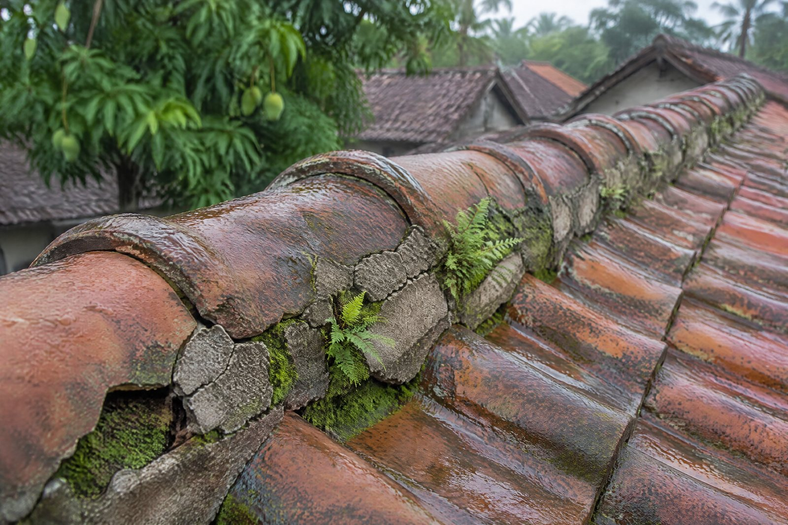
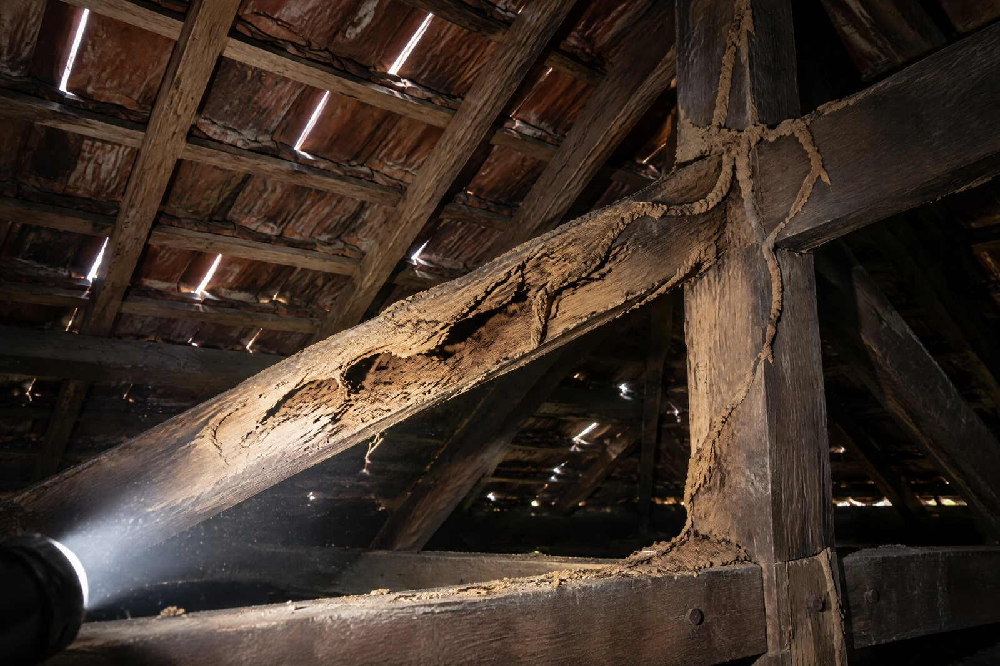

Banyak daftar "atap paling awet" ditulis oleh penjual salah satu bahannya, dan Atapura juga penjual: kami hanya memasang genteng aspal, yang juga disebut atap bitumen atau shingle. Karena itu angka umur di artikel ini tidak kami tulis sendiri. Semuanya diambil dari tabel pihak ketiga, termasuk bagian yang menempatkan genteng aspal di bawah genteng tanah liat dan beton.

## Jenis atap rumah apa yang paling awet dan tahan lama?

Genteng tanah liat, keramik, dan beton paling lama umurnya di tabel acuan, disusul atap metal, lalu genteng aspal. Umur sebenarnya tetap bergantung pada rangka, pemasangan, dan iklim.

| Bahan atap | Perkiraan umur (tabel Amerika Serikat) | Catatan untuk rumah di sini |
|---|---|---|
| Genteng tanah liat, keramik, dan beton | Lebih dari 50 tahun (NAHB), 100 tahun lebih (InterNACHI), 40 tahun (Fannie Mae) | Paling berat; genteng keramik butuh kemiringan minimal 25–30° |
| Metal (spandek, galvalum, genteng metal) | 40–80 tahun (InterNACHI), 40 tahun (Fannie Mae) | Ketebalan dan lapisan lembaran di pasaran beragam, cek lembar data |
| Genteng aspal berlapis | 30 tahun (InterNACHI) | Iklim panas memangkas umurnya |
| Genteng aspal satu lapis | 20 tahun (InterNACHI, Fannie Mae) | Iklim panas memangkas umurnya |
| Fiber semen | 25 tahun (NAHB, InterNACHI) | Berbeda dengan lembaran asbes, lihat di bawah |
| UPVC dan lembaran bitumen gelombang | Tidak tercantum | Pegang garansi tertulis produsennya |

Kami tidak menemukan tabel umur pakai resmi per jenis penutup atap di Indonesia. Tiga acuan di atas banyak dikutip, dan ketiganya dimuat ulang dalam satu lampiran laporan teknis Port of Seattle: studi umur komponen rumah dari NAHB, asosiasi pengembang dan kontraktor rumah Amerika Serikat (2007); bagan perkiraan umur dari InterNACHI, asosiasi inspektur rumah; dan tabel umur pakai yang dipakai Fannie Mae, lembaga pembiayaan rumah, untuk menilai gedung hunian multi-unit seperti apartemen.

Tabel keempat di lampiran yang sama, dari DCA Office of Affordable Housing (2011), memberi genteng 30 tahun dan atap metal 40 tahun. Jadi urutannya tidak selalu sama di setiap tabel. Angka-angka ini perkiraan kasar untuk membandingkan, bukan janji umur.

Genteng keramik berglasir adalah genteng tanah liat bakar yang diberi lapisan glasir, jadi masuk baris yang sama. Genteng aspal satu lapis adalah lembaran tipis dengan tiga lidah yang sama rata. Yang berlapis direkatkan dua lapis atau lebih sehingga lebih tebal dan bertekstur. Studi NAHB menulis sekitar 20 tahun untuk genteng aspal tanpa membedakan keduanya. Baris "modified bitumen 20 tahun" yang muncul di beberapa tabel adalah membran untuk dak beton, bukan genteng aspal atau lembaran bitumen gelombang.

## Tiga catatan sebelum memakai angka itu

**Iklim ikut menentukan.** Studi NAHB menulis bahwa umur atap bergantung pada cuaca setempat, desain dan cara membangun, mutu bahan, dan perawatan. Bagan InterNACHI lebih tegas untuk satu bahan: iklim panas memangkas umur genteng aspal secara drastis. Jabodetabek panas sepanjang tahun, jadi angka Amerika untuk genteng aspal bisa terlalu tinggi untuk rumah di sini. Pegangan tertulis yang berlaku di sini adalah garansi pabrik, misalnya Maxxi 25 tahun untuk Maxxiroof dan 30 tahun untuk Promaxxi, CTI 30 tahun. Garansi itu janji bersyarat dari pabrik, bukan perkiraan umur. Penjelasannya ada di [atap bitumen tahan berapa lama](/panduan/atap-bitumen-tahan-berapa-lama).

**Mutu genteng menentukan.** Angka 50 sampai 100 tahun lebih untuk genteng tanah liat dan beton mengandaikan genteng bermutu baik yang dipasang benar. Genteng yang mudah pecah atau menyerap air tidak akan mencapai angka itu.

**Angka metal berasal dari pasar Amerika.** Lembaran metal yang dijual di sini beragam ketebalan dan lapisan pelindungnya. Bandingkan keduanya di lembar data, karena dua lembar yang terlihat sama di toko bisa berbeda jauh. UPVC tidak ada di tabel umur mana pun yang kami pakai. Untuk umurnya, pegang garansi tertulis produsen, bukan klaim di iklan.

## Atap asbes tidak masuk pilihan

Lembaran asbes gelombang masih menutup banyak rumah: studi berbasis data BPS mencatat 52,1% rumah di DKI Jakarta beratap asbes. WHO menyatakan semua jenis asbes bersifat karsinogenik, dengan risiko terbesar saat lembarannya dipotong, dibor, pecah, atau dibongkar. Lembaran asbes bukan pilihan untuk atap baru, dan menggantinya perlu cara yang aman. Langkahnya ada di [ganti atap asbes](/panduan/ganti-atap-asbes).

## Yang biasanya rusak duluan: sambungan dan talang, lalu rangka yang tidak terawat

Gentengnya bisa masih utuh saat atapnya sudah bocor. Bagan InterNACHI mencatat bahwa flashing (lembaran penutup sambungan di pertemuan atap dengan dinding dan di lembah atap) yang terawat bisa bertahan lama, tetapi titik sambungnya yang cenderung gagal. Karena itu periksa secara berkala, misalnya menjelang musim hujan. Talang juga lebih pendek umurnya: tabel Fannie Mae memberi talang luar 10 tahun, studi NAHB 20 tahun untuk talang aluminium, tetap di bawah umur genteng mana pun.

*Ilustrasi, bukan proyek Atapura. Genteng masih utuh, adukan bubungannya yang retak.*

Pola kerusakannya berbeda per bahan:

- **Genteng tanah liat, keramik, dan beton:** genteng bergeser atau pecah terinjak saat ada perbaikan, dan bubungan yang direkatkan adukan semen retak.
- **Genteng aspal:** bocor di paku yang meleset dari jalur paku dan di papan alas yang pernah basah. Keduanya kesalahan pemasangan, bukan umur bahan.
- **Atap metal:** bocor di sekrup dan sambungan antarlembar, juga karat di bagian yang lapisannya tergores.

Rangka memiliki umur paling panjang di ketiga tabel. Fannie Mae menulis lebih dari 50 tahun untuk struktur atap, selama rangkanya tidak dimakan rayap, tidak berkarat, dan tidak menanggung beban di luar hitungannya. Rangka kayu yang keropos atau baja ringan yang melendut membuat genteng semahal apa pun ikut dibongkar. Perbandingan bahan rangkanya ada di [rangka atap bitumen: baja ringan atau kayu](/panduan/rangka-atap-bitumen-baja-ringan-atau-kayu).

*Ilustrasi, bukan proyek Atapura. Rangka yang keropos memaksa seluruh atap dibongkar, apa pun gentengnya.*

## Paling awet belum tentu paling cocok

Genteng yang paling lama umurnya juga yang paling berat. Genteng keramik sekitar 39–46 kg per m² menurut spesifikasi distributor, genteng aspal 8,7–12,3 kg per m² menurut lembar data pabrik. Pedoman pembebanan PPURG 1987 menghitung atap genteng beserta reng dan usuknya 50 kg per m². Genteng keramik yang berat bisa melewati angka itu setelah reng dan usuk dihitung, jadi cocokkan berat produk dengan hitungan rangkanya. Rumah yang rangkanya sudah tua, atau yang ditambah lantai, perlu dicek lebih dulu. Hitungannya ada di [genteng aspal vs genteng beton: beban rangka](/panduan/atap-bitumen-vs-genteng-beton-beban-rangka).

Berat atap juga ikut dihitung saat gempa. Dalam SNI 1726:2019, gaya gempa yang ditahan bangunan sebanding dengan berat seismik efektifnya, dan berat atap termasuk di dalamnya.

Kemiringan membatasi pilihan berikutnya. Produsen genteng keramik mencantumkan kemiringan minimal 25–30°. Genteng aspal umumnya mulai 15°, dan merek tertentu bisa 10–15° dengan cara pasang khusus. Lembaran metal profil bisa jauh lebih landai.

## Memilih menurut keadaan rumah

| Keadaan rumah | Yang masuk akal | Alasannya |
|---|---|---|
| Rumah baru, rangka dihitung untuk genteng berat, sudut sesuai lembar data genteng (25–30° atau lebih) | Genteng tanah liat, keramik, atau beton | Umur bahan paling panjang di tabel NAHB dan InterNACHI |
| Ganti atap di rangka lama, rumah bertingkat, atau tambah lantai | Genteng aspal atau metal | 3–5 kali lebih ringan dari genteng keramik |
| Atap 15–25° (10–15° hanya merek tertentu dengan cara pasang khusus) | Genteng aspal atau metal | Di bawah batas minimal genteng keramik |
| Atap di bawah 10° | Lembaran metal profil, atau naikkan kemiringan rangka | Di bawah batas genteng aspal |
| Bentuk atap banyak jurai dan lembah | Genteng aspal | Lembarannya dipotong dan ditekuk mengikuti bentuk di atas papan rata |

Belum tahu sudut atap rumah Anda? Cara mengukurnya ada di [kemiringan atap bitumen minimal](/panduan/kemiringan-atap-bitumen-minimal), atau tim kami mengukurnya saat survey. Kalau rumah Anda masuk baris kedua, kirim foto atap dari luar dan dari bawah plafon lewat WhatsApp. Kami bisa menilai lebih dulu apakah rangkanya perlu diperkuat sebelum survey.

Kalau suara hujan atau panas di bawah atap ikut jadi pertimbangan, perbandingannya ada di [atap bitumen vs UPVC, spandek, dan genteng metal](/panduan/atap-bitumen-vs-upvc-spandek-genteng-metal) dan [atap bitumen berisik saat hujan?](/panduan/atap-bitumen-berisik-saat-hujan). Perbandingan langsung dengan genteng keramik ada di [genteng aspal vs genteng keramik dan tanah liat](/panduan/atap-bitumen-vs-genteng-keramik-tanah-liat), dan biaya genteng aspal dari material sampai jasa pasang ada di [harga atap bitumen per m²](/panduan/harga-atap-bitumen-per-m2).

## Kalau pilihannya jatuh ke genteng aspal

Umurnya paling banyak ditentukan tiga hal: papan alas yang tetap kering, paku di jalur yang benar, dan sambungan di bubungan, lembah, serta pertemuan dengan dinding. Atapura memasang mengikuti panduan merek yang dipasang dan memberi [garansi pemasangan 5 tahun](/garansi) tertulis untuk kebocoran dan kesalahan pasang, di luar garansi pabrik. Perawatannya cukup ringan dan dibahas di [perawatan atap bitumen](/panduan/perawatan-atap-bitumen).

Kalau rangka Anda kuat dan kemiringannya cukup, genteng keramik atau beton tetap pilihan yang wajar. Kalau beban, sudut, atau bentuk atap jadi pertimbangan, coba hitung biaya genteng aspal untuk luas atap Anda di [kalkulator atap bitumen](/hitung). Survey di Jabodetabek tanpa biaya, dan tim kami ikut memeriksa kondisi rangka saat itu. Anda juga bisa mengirim foto atap lewat WhatsApp lebih dulu.
