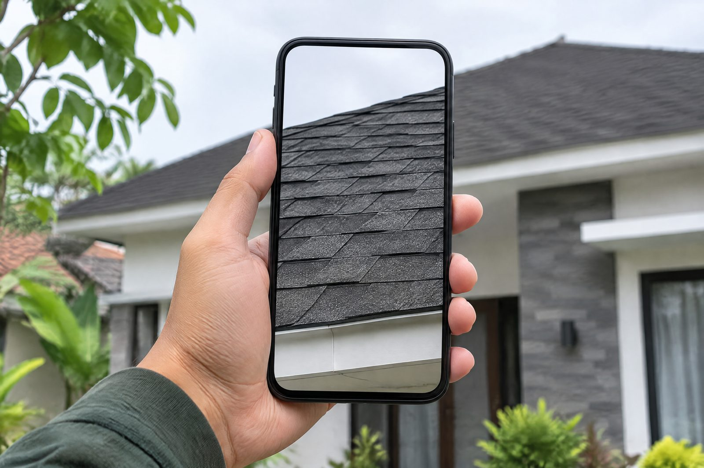
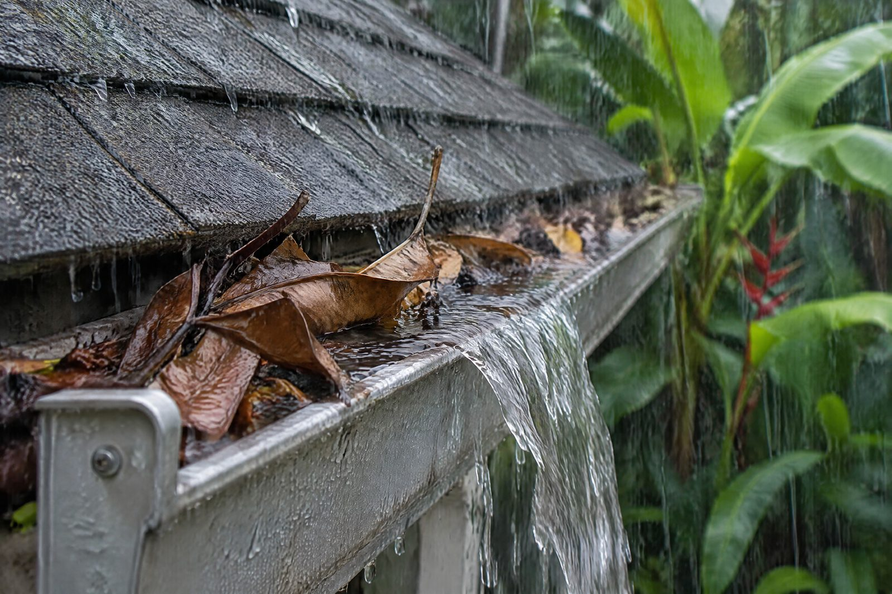

Atap bitumen tidak butuh perawatan yang rumit. Banyak kerusakan atap bermula dari hal sederhana yang terlewat: daun menumpuk di lembah atap, talang tersumbat, dahan menaungi satu sisi atap bertahun-tahun, atau atap yang disemprot terlalu keras. Berikut jadwal dan caranya, dari yang bisa Anda kerjakan dari halaman sampai yang sebaiknya diserahkan ke tukang.

## Jadwal perawatan

| Kapan | Yang dikerjakan | Dikerjakan dari |
|---|---|---|
| Saat daun mulai menumpuk | Tiup daun ke bawah mengikuti kemiringan, dari lembah atap dan talang | Atas atap, oleh tukang |
| Awal musim hujan | Bersihkan talang, cek sambungannya, pangkas dahan yang menaungi atap | Tangga dan halaman |
| Setelah angin kencang | Cari genteng yang terangkat, melengkung, atau hilang | Halaman |
| Setelah hujan deras pertama | Cari noda baru di plafon dan papan di ruang bawah atap | Dalam rumah |
| Saat lumut terlihat | Bersihkan dengan campuran pemutih dan air 1:1; noda alga boleh dibiarkan | Atas atap, oleh tukang |

Jadwal ini saran Atapura untuk iklim Jabodetabek; pabrikan dan ARMA hanya menyebut "secara berkala". Waktu awal dan puncak hujan per wilayah, menurut BMKG, ada di [cek atap sebelum puncak hujan](/panduan/checklist-atap-sebelum-puncak-hujan-jabodetabek).

## Bolehkah atap bitumen diinjak? Periksa dari bawah saja

Sebisa mungkin jangan. Asosiasi produsen atap aspal Amerika (ARMA) meminta pemilik rumah tidak naik ke atap karena berbahaya dan bisa merusak genteng; pemeriksaan cukup dari tanah dengan teropong. Kalau tidak punya teropong, zoom kamera HP dari halaman atau jendela lantai atas juga cukup. Yang dicari: genteng yang retak, melengkung, atau hilang, dan butiran batu yang banyak rontok.

*Ilustrasi, bukan proyek Atapura. Foto atap dari beberapa sisi halaman dan simpan, supaya bisa dibandingkan setelah angin kencang berikutnya.*

Lalu periksa dari dalam. Buka lubang akses plafon, arahkan senter ke ruang bawah atap, dan cari noda atau bagian basah di sisi bawah papan alas (lembaran tempat genteng dipaku) dan rangka. Menurut ARMA, noda seperti itu tanda ada air yang masuk.

## Cara membersihkan atap bitumen dari daun dan debu

Pabrikan CTI menyebut genteng aspalnya cukup dibersihkan atau disapu dari debu dan daun secara berkala, karena lapisan butiran keramiknya menolak air sehingga debu dan air tidak mudah menempel. ARMA menyarankan daun yang menumpuk dibersihkan dengan peniup daun atau cara lain yang tidak menggores, dengan arah tiupan ke bawah mengikuti kemiringan atap supaya kotoran tidak masuk ke bawah tepi genteng.

Bagian yang paling perlu dijaga adalah lembah atap, tempat dua bidang bertemu dan air dari keduanya berkumpul. Daun yang menumpuk di sana menahan air dan menjadi tempat lumut tumbuh.

## Talang

Talang yang tersumbat membuat air meluap ke tepi atap dan dinding. ARMA meminta talang dijaga tetap bersih, dan memberi satu aturan yang sering dilanggar di rumah dua lantai: talang dari atap atas jangan dibuang langsung ke atap bawah. Pipanya disambung sampai masuk ke talang atap bawah.

*Ilustrasi, bukan proyek Atapura. Cara paling mudah mengecek talang: lihat saat hujan deras. Air yang melimpas di atas bibir talang tandanya talang atau pipanya tersumbat.*

Titik rawan di sekitar talang dan flashing (lembar penutup sambungan di pertemuan atap dengan dinding atau pipa) dibahas di [nok, flashing, dan talang](/panduan/nok-flashing-talang-atap-bitumen).

## Cara membersihkan lumut dan noda gelap

Noda dan garis-garis kehitaman di atap biasanya alga. Menurut ARMA, tidak ada bukti ilmiah bahwa alga merusak genteng aspal; dampaknya pada tampilan. Lumut berbeda: lumut bisa mengangkat tepi bawah genteng sehingga lebih mudah terangkat angin, membuat air mengalir ke samping di bawah genteng, dan bahkan menyebabkan bocor.

Cara membersihkan yang disarankan ARMA:

1. Lindungi dulu tanaman dan area di sekitar rumah dari cipratan dan aliran larutan. Jauhkan anak dan hewan peliharaan, dan alihkan pipa talang yang mengalir ke tampungan air hujan atau kolam sampai bilasan selesai. Pekerja memakai sarung tangan, kacamata, dan alas kaki yang tidak licin.
2. Campur pemutih pakaian cair berbahan klorin dengan air, perbandingan 1:1. Ikuti peringatan di label kemasannya dan jangan dicampur dengan pembersih lain.
3. Semprotkan ke permukaan atap dan diamkan 15–20 menit. Boleh lebih lama, asal larutannya tidak sampai mengering.
4. Bilas sampai bersih dengan air bertekanan rendah.

Alga akan hilang terbawa hujan berikutnya. Lumut melonggar seiring waktu dan bisa dibersihkan dengan peniup daun; pada lumut yang parah, penyemprotan pemutih mungkin perlu diulang. Karena pekerjaan ini dilakukan di atas atap, serahkan ke tukang.

Pencegahannya: pangkas dahan yang menaungi atap supaya matahari bisa mengeringkannya. Strip seng atau tembaga yang diselipkan di bawah genteng bisa dipertimbangkan saat atap diganti baru. ARMA tidak menyarankannya untuk atap yang sudah jadi: pakunya terbuka dan lama-lama bisa bocor, atau lem perekat antargenteng terlepas sehingga genteng mudah terangkat angin. Kondisi di daerah berpohon dan berkabut dibahas di [atap villa di Puncak dan Bogor](/panduan/atap-villa-puncak-bogor).

## Yang jangan dilakukan

- **Menyemprot dengan air bertekanan tinggi.** Butiran batu di permukaan genteng rontok, dan atap cepat rusak.
- **Mengecat atau melapis ulang atap.** ARMA tidak menyarankannya, karena lapisan itu bisa membuat genteng melengkung dan butirannya lepas.
- **Naik ke atap tanpa perlu.** Berbahaya dan bisa merusak genteng.
- **Membuat lubang baru tanpa flashing**, misalnya untuk antena atau dudukan AC. Lubang seperti ini sering menjadi sumber bocor; penjelasannya ada di [atap bitumen bocor](/panduan/atap-bitumen-bocor).

## Memilih tukang untuk membersihkan atap

Atapura tidak membuka jasa pembersihan atap. Pekerjaan ini bisa dikerjakan tukang atap atau tukang bangunan yang biasa naik atap. Sebelum mulai, sampaikan tiga hal: tidak memakai jet cleaner, tidak menginjak lembah atap dan tepi genteng, dan daun ditiup atau disapu searah kemiringan atap. Sepakati ongkosnya di depan.

## Kapan atap perlu diganti

ARMA menyebut atap rumah yang berumur lebih dari 20 tahun mulai layak dipertimbangkan untuk diganti. Tandanya terlihat dari bawah: genteng retak, melengkung, atau hilang, dan butiran batu yang banyak rontok. Dari ruang bawah atap, cari noda atau bagian basah di papan. Umur dan garansi tiap merek dibahas di [atap bitumen tahan berapa lama](/panduan/atap-bitumen-tahan-berapa-lama).

**Atap dipasang Atapura.** Kebocoran akibat pemasangan atau genteng yang terlepas bukan karena bencana, dalam masa garansi pemasangan 5 tahun sejak serah terima, cukup dilaporkan lewat WhatsApp dengan foto atau video. Perawatan di artikel ini tetap tanggung jawab pemilik rumah: garansi tidak menanggung talang tersumbat yang tidak dibersihkan, dan tidak berlaku bila atap diubah atau diperbaiki pihak lain, misalnya dilubangi untuk antena. Kalau tukang perlu naik atau melubangi atap, tanyakan ke kami dulu. Rinciannya ada di halaman [garansi](/garansi).

**Atap dipasang pihak lain.** Hubungi pemasangnya lebih dulu. Yang bisa kami bantu: menyediakan material genteng aspal untuk tukang Anda, atau survey tanpa biaya di Jabodetabek bila atap memang sudah waktunya diganti. Perkiraan biayanya bisa dihitung di [Hitung AKAL](/hitung).
