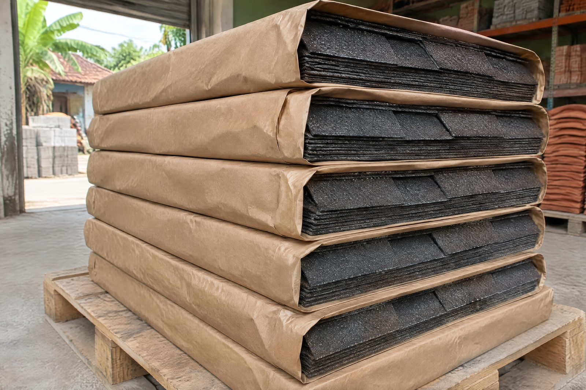

Toko dan marketplace sering menulis harga genteng aspal per lembar atau per pack, sedangkan kontraktor menulis harga per m². Akibatnya dua penawaran sulit dibandingkan. Di bawah ini semuanya kami ubah ke satuan yang sama, per seri, dari daftar harga Atapura untuk Jabodetabek yang berlaku sejak 20 November 2026.

## Ukuran atap bitumen per lembar dan isi 1 bundel

| Seri | Ukuran per lembar | Isi per bundel |
|---|---|---|
| Maxxiroof | 1.000 × 333 mm | 21 lembar, 3,10 m² |
| Promaxxi (laminasi, dua lapis) | 1.000 × 333 mm | 16 lembar, 2,32 m² |
| CTI CT3 | 1.000 × 333 mm | 21 lembar, 3 m² |
| CTI CT5 | 1.000 × 317,5 mm | 22 lembar, 3 m² |
| CTI CT6 (segi enam) | 1.000 × 317,5 mm | 17 lembar, 2,32 m² |
| Victory | Belum ada data resmi | 21 lembar, 3 m² |
| Tegola Premium Rectangular | 1.000 × 340 mm | 21 lembar, 3,05 m² |
| Tegola Premium Mosaik, Gothik | 1.000 × 337 mm | 3,45 m² |
| Tegola Top Shingles | 1.000 × 340 mm | 3,5 m² |
| Tegola Eco Roof | 1.000 × 340 mm (Hexagonal 337 mm) | 2,32 m² (Hexagonal 2,30 m²) |

Javabitumen belum kami cantumkan ukurannya karena dokumen resminya belum memuat angka itu. Untuk seri Tegola yang hanya mencantumkan luas per bundel, jumlah lembarnya tidak kami tebak.

*Ilustrasi, bukan proyek Atapura. Genteng aspal dijual per bundel; isi dan luas tutupnya tertulis di kemasan tiap seri.*

## Tebal atap bitumen

Tebal atap bitumen berbeda per jenis: Maxxiroof 3-tab (lembar dengan tiga potongan lidah di tepi bawah) 2,66 mm, sedangkan Promaxxi laminasi dua lapis 5,2 mm, hampir dua kali lipat. CTI, Victory, dan Javabitumen tidak mencantumkan tebal di halaman produk resmi yang kami periksa. Beda 3-tab dan laminasi dijelaskan di [jenis genteng aspal](/panduan/atap-bitumen-genteng-aspal-sirap-shingle), dan beratnya per seri di [berat atap bitumen per m²](/panduan/berat-atap-bitumen-per-m2).

## Harga atap bitumen per pack (bundel) dan per lembar

| Seri | Harga per bundel | Kira-kira per lembar |
|---|---|---|
| Maxxiroof | Rp449.500 | Rp21.400 |
| Promaxxi | Rp336.400 | Rp21.000 |
| CTI CT3 | Rp465.000 | Rp22.100 |
| CTI CT5 | Rp465.000 | Rp21.100 |
| CTI CT6 | Rp359.600 | Rp21.200 |
| Javabitumen | Rp435.000 | Tidak dihitung |
| Victory Standar | Rp600.000 | Rp28.600 |
| Victory Two Tone | Rp660.000 | Rp31.400 |
| Tegola Premium Rectangular | Rp1.281.000 | Rp61.000 |
| Tegola Top Shingles | Rp1.260.000 | Tidak dihitung |
| Tegola Eco Roof Rectangular | Rp730.800 | Tidak dihitung |

Harga per bundel adalah harga per m² dikali luas tutup satu bundel: Rp145 ribu per m² untuk Maxxi dan Javabitumen, Rp155 ribu untuk CTI, Rp200–220 ribu untuk Victory, dan Rp315–420 ribu untuk seri Tegola. Harga per lembar hanya untuk perbandingan, karena genteng aspal dijual per bundel; seri tanpa jumlah lembar resmi tidak kami hitung per lembarnya. Harga ini mengikuti daftar harga 20 November 2026 dan bisa berubah. Angka final dan masa berlakunya tertulis di penawaran.

Harga per lembar yang mirip belum tentu berarti harga per m² yang sama. CTI CT6 sekitar Rp21.200 per lembar, sedikit di bawah Maxxiroof Rp21.400, tetapi CT6 butuh sekitar 7,3 lembar per m², sehingga harga per m²-nya Rp155 ribu, sedangkan Maxxiroof Rp145 ribu. Untuk membandingkan, pakai harga per m².

## Berapa lembar genteng aspal per m²?

Untuk 1 m² atap, sekitar 7 lembar. CTI CT3 21 lembar per 3 m², Maxxiroof 21 lembar per 3,10 m², Victory 21 lembar per 3 m². Promaxxi sekitar 6,9 lembar dan CTI CT6 sekitar 7,3 lembar per m². Angka ini hanya gambaran, karena pesanan selalu dihitung per bundel.

## Cara menghitung kebutuhan bundel

1. Hitung luas bidang atap, bukan luas lantai. Atap miring selalu lebih luas dari denahnya.
2. Tambahkan 10% untuk potongan di tepi, jurai (garis tempat dua bidang atap bertemu), dan sambungan.
3. Bagi dengan luas tutup satu bundel, lalu bulatkan ke atas.

Contoh untuk atap 100 m²:

| Seri | Isi per bundel | Kebutuhan |
|---|---|---|
| CTI CT3 | 3 m² | 37 bundel |
| Maxxiroof | 3,10 m² | 36 bundel |
| Promaxxi | 2,32 m² | 48 bundel |

Starter (lajur dasar di tepi bawah atap) dan nok (penutup puncak atap, dibuat dari lembar genteng yang dipotong tiga) dihitung terpisah dari seri yang sama, begitu juga papan alas, underlayer, flashing, paku, dan sekrup. Detail nok dan flashing ada di [nok, flashing, dan talang](/panduan/nok-flashing-talang-atap-bitumen).

## Membandingkan dengan harga di marketplace

Sebelum membandingkan, tanyakan empat hal ke penjual: seri apa, isi berapa lembar per bundel atau pack, menutup berapa m², dan apakah sudah termasuk ongkos kirim. Bagi harganya dengan luas tutup untuk mendapat harga per m². Harga per lembar yang lebih rendah bisa berarti lembarnya lebih sempit atau isinya lebih sedikit. Penawaran kontraktor per m² biasanya sudah memuat papan alas, underlayer, dan jasa pasang, jadi bandingkan dengan harga terpasang, bukan harga genteng saja.

## Harga genteng saja vs harga terpasang

Harga di atas adalah harga gentengnya saja. Genteng aspal harus dipasang di atas papan alas, bukan langsung di reng, jadi masih ada biaya papan alas, underlayer, flashing, paku, dan jasa pasang. Di daftar harga Atapura, genteng Maxxi, Javabitumen, dan CTI Rp145–155 ribu per m², sedangkan terpasang lengkap Rp380–450 ribu per m². Rinciannya ada di [harga atap bitumen per m²](/panduan/harga-atap-bitumen-per-m2), dan isi jasa pasangnya di [harga jasa pasang atap bitumen](/panduan/ongkos-jasa-pasang-atap-bitumen). Estimasi biaya terpasang untuk luas atap Anda bisa dicoba di [Hitung AKAL](/hitung).

## Beli material saja atau sekalian dipasang

Kalau tukang Anda sudah biasa memasang genteng aspal, Atapura melayani pembelian material saja: genteng, papan alas, underlayer, flashing, paku, dan aksesoris. Kirim luas atap, bentuk atap, seri pilihan, dan lokasi lewat WhatsApp; admin mengirim penawaran tertulis berisi jumlah bundel, starter, nok, dan aksesorisnya. Untuk Jabodetabek, harga sudah termasuk ongkos kirim, dan material dibayar lunas sebelum dikirim. Cacat produk diklaim lewat garansi pabrik masing-masing merek; garansi pemasangan 5 tahun dari Atapura hanya berlaku untuk atap yang dipasang tim Atapura.

Kalau ingin sekalian dipasang, tim kami survey gratis di Jabodetabek lalu menulis angka finalnya. Beda tiap merek ada di [perbandingan merek atap bitumen](/panduan/perbandingan-merek-atap-bitumen).
